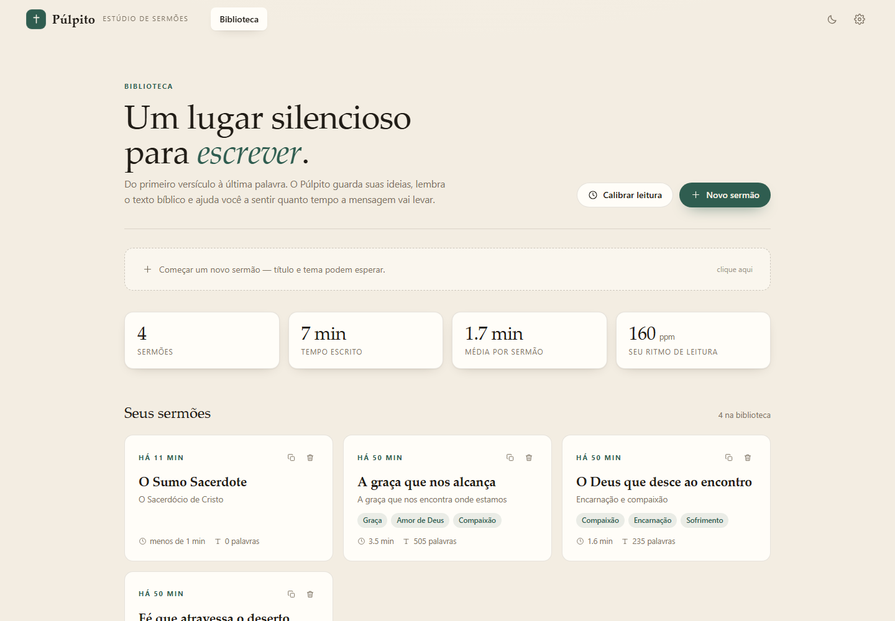
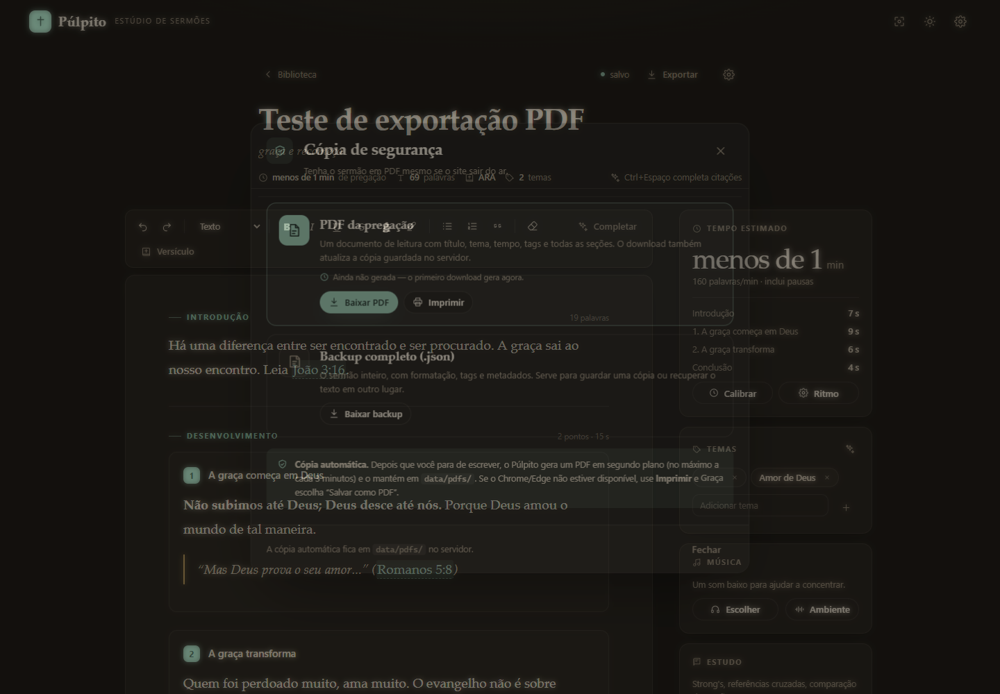
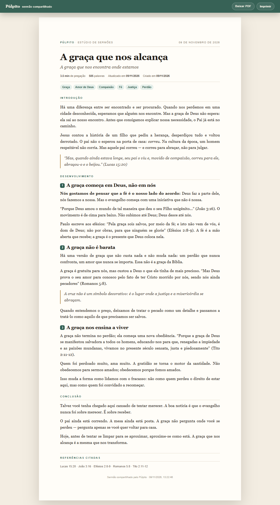

# Púlpito · Estúdio de Sermões

> Um lugar silencioso para escrever, estudar e medir a mensagem.

O **Púlpito** é um aplicativo web para pregadores prepararem sermões sem a
poluição de um editor genérico. A tela é organizada em **introdução**,
**desenvolvimento** (quantos pontos você quiser) e **conclusão**; o texto
bíblico aparece quando você precisa, e o tempo da pregação é estimado a partir
do seu próprio ritmo de leitura.

Backend em **Node.js + Express**, frontend em **React + Vite**, dados locais em
JSON. Sem cadastro, sem nuvem obrigatória: tudo fica na sua máquina.



---

## O que está pronto

### Escrita
- Editor por blocos: **introdução**, **desenvolvimentos** (adicionar, remover,
  reordenar) e **conclusão**.
- Formatação rica: negrito, itálico, sublinhado, riscado, **cor do texto**,
  **grifo**, títulos, subtítulos, citação, listas e limpeza de formatação.
- Campo de **tema** e título sempre visíveis.
- Salvamento automático (a cada ~0,85 s) com indicador de estado.
- **Modo foco** (esconde painéis), modo claro/escuro, fonte com ou sem serifa,
  tamanho do texto e largura de leitura.
- Contagem de palavras e tempo estimado por seção.

### Bíblia
- **15 traduções em português** disponíveis (ARA, NAA, NTLH, ARC09, ACF11, KJA,
  NVT, TB10, OL, VFL, NBV07, ALM21, CNBB, MENS, NTJud), via API pública
  [bolls.life](https://bolls.life).
- Leitura por livro/capítulo, busca por palavra/frase e **comparação de 2 a 4
  versões lado a lado**.
- Inserção de versículo no sermão com referência automática.
- **Tooltip ao passar o mouse** em qualquer referência do texto (ex.: `João 3:16`).
- **Autocompletar de citação**: ao digitar `"Porque Deus amou o mundo`, o app
  reconhece o versículo, mostra a prévia **na versão escolhida** e completa o
  texto + `(João 3:16)` com `Tab`. Também funciona com `Ctrl+Espaço` ou pelo
  botão **Completar** da barra de ferramentas.
- **Vários versículos de uma vez**: no painel Bíblia, use checkboxes ou
  `Shift`/`Ctrl` para selecionar uma faixa e versículos alternados, ou digite
  várias referências separadas por `;` (ex.: `João 3:16; Rm 5:8; Ef 2:8-9`) em
  **Adicionar várias referências**. Cada bloco entra com sua própria referência.
- Referências são detectadas no texto e transformadas em chips clicáveis
  (sem alterar o texto salvo).

### Estudo
- **Referências cruzadas** para 29.364 versículos (base OpenBible.info, CC-BY),
  ordenadas por relevância.
- **Dicionário Strong's** (BDBT: Brown-Driver-Briggs / Thayer) por número
  (`G26`, `H430`) ou termo em inglês; acesso rápido a 46 entradas frequentes com
  rótulo em português.
- **Comentários**: 21 notas de estudo originais para passagens-chave, notas de
  rodapé da tradução e um espaço para **suas próprias notas**, salvas por
  referência.
- Painel único com abas Passagem / Referências / Strong's / Comentários, e
  inserção direta no sermão.

### Tempo e temas
- **Calibração de leitura**: você lê um texto de ~197 palavras em voz alta, o
  app mede o tempo e calcula suas **palavras por minuto**. Também é possível
  informar o ritmo manualmente.
- Estimativa por seção e total, com fator de pausas (respiração, transições).
- **Tags automáticas** a partir do texto e do tema (taxonomia de 32 assuntos,
  com limiar para evitar ruído), editáveis à mão.
- Biblioteca com estatísticas: total de sermões, tempo escrito, média por sermão
  e **os temas que você mais prega**.

### Cópia de segurança
- **PDF automático**: depois que você para de escrever, o servidor gera um PDF
  em segundo plano (no máximo a cada 3 minutos) e guarda em
  `data/pdfs/<id>.pdf`. Se o app sair do ar, o arquivo continua no disco.
- **Exportar** no editor: baixar o PDF na hora, baixar um **backup completo em
  JSON** e **imprimir/salvar como PDF** pelo navegador.
- O PDF inclui título, tema, tempo estimado, tags, introdução, pontos,
  conclusão e a lista de referências citadas.
- O download manual também atualiza a cópia de segurança.
- Requer Chrome ou Edge instalado para a geração direta; sem eles, a opção
  **Imprimir** usa o diálogo do navegador (“Salvar como PDF”).



### Compartilhar
- **Link de leitura por sermão**: uma página pública, limpa, sem editor, com
  botões de **Baixar PDF** e **Imprimir**.
- O token é aleatório e pode ser **revogado** a qualquer momento.
- Na rede local, outros dispositivos abrem o link, mas **não** o editor: o
  servidor bloqueia as rotas de edição para quem não é o computador local.
- Para internet, use um túnel ou uma hospedagem (veja abaixo).
- Isto é **compartilhar um sermão**, não multiusuário: outras pessoas não criam
  seus próprios sermões no app.



### Música
- Player embutido para **YouTube** e **Spotify** (link colado ou sugestões).
- **Som ambiente gerado no navegador** (ruído suave + pad) — funciona offline,
  sem depender de API.
- Busca automática opcional: configure `YOUTUBE_API_KEY` e/ou credenciais do
  Spotify no `.env`.


## Compartilhar com outras pessoas

### Mesma rede Wi‑Fi

Neste projeto, o `.env` está configurado com `HOST=0.0.0.0`. Se você criou o
seu a partir do `.env.example`, confira:

```env
HOST=0.0.0.0
PORT=4000
```

1. Reinicie o Púlpito.
2. No editor, clique em **Compartilhar** e crie o link.
3. O painel mostra o endereço de rede, por exemplo
   `http://192.168.1.28:4000/s/...`. Envie esse link.
4. Se não abrir em outro aparelho, libere a porta **4000** no firewall do
   Windows (Redes privadas).

O endereço `127.0.0.1` só funciona no próprio computador; use o endereço
`192.168.x.x` mostrado no painel.

### Internet

O link só funciona enquanto o computador que roda o Púlpito estiver ligado e
acessível. Para abrir fora de casa, as opções são:

- **Túnel** (Cloudflare Tunnel, ngrok) apontando para a porta 4000;
- **Hospedagem** (VPS, Render, Railway, Fly.io) com disco persistente para
  `data/`;
- definir `PULPITO_PUBLIC_URL=https://seu-endereco` para o painel montar o link
  público.

> **Segurança:** o app não tem login. Na rede local, o Púlpito bloqueia o
> editor para outros IPs e libera apenas `/s/<token>` e `/api/share/*`. Atrás de
> um túnel, o servidor pode enxergar a conexão como local; nesse caso, proteja o
> túnel com autenticação ou use uma hospedagem com login. Não use
> `PULPITO_ALLOW_REMOTE_EDIT=1` em rede pública.

### Se a outra pessoa não conseguir abrir

- Envie o **PDF** (Editor → Exportar → Baixar PDF): funciona sem rede e sem
  servidor ligado.
- Confirme se o celular/PC está na mesma Wi‑Fi.
- Teste `http://SEU_IP:4000/api/health` no aparelho.
- Verifique o firewall do Windows.

---

## Stack

| Camada | Tecnologia |
| --- | --- |
| Frontend | React 18, Vite 5, CSS próprio (sem framework de UI) |
| Backend | Node.js 20+, Express 4 |
| Persistência | JSON local (`data/pulpito.json`) com escrita atômica |
| Bíblia | [bolls.life](https://bolls.life) (sem chave) |
| Referências cruzadas | OpenBible.info (CC-BY) |
| Testes | `node:test` + Playwright (verificação de UI) |

Sem banco externo, sem Docker, sem login.

---

## Como rodar

### Pré-requisitos
- **Node.js 20+** (o `playwright-core` usado no PDF exige Node 20)
- **pnpm 11** (recomendado; o lockfile oficial é `pnpm-lock.yaml`)
- **Chrome ou Edge** para gerar o PDF direto (opcional; sem ele, use a opção
  **Imprimir / Salvar como PDF** do navegador)

Se ainda não tem pnpm:

```bash
corepack enable
corepack prepare pnpm@11.28.5 --activate
```

### Instalação

```bash
cd pulpito
pnpm install
copy .env.example .env      # Windows; no Linux/macOS: cp .env.example .env
pnpm setup                  # opcional: regenera o índice de citações
```

> `pnpm setup` só é necessário se você quiser atualizar `quotes.json` ou se os
> dados não vierem no pacote. Os dados de referências cruzadas e citações já
> estão incluídos.
>
> O `.env` não é versionado. Em um clone novo, ele não existe: sem ele o app
> escuta em `127.0.0.1`. Para compartilhar na rede, coloque `HOST=0.0.0.0` no
> `.env` e reinicie.

### Desenvolvimento

```bash
pnpm dev
```

- App: <http://127.0.0.1:5173>
- API: <http://127.0.0.1:4000>

O Vite faz proxy de `/api` para o Express.

### Produção (build + servidor único)

```bash
pnpm build
pnpm start
```

Acesse <http://127.0.0.1:4000>. O Express serve o build do Vite.
O `server/public/` é gerado pelo build e não é versionado.

### Primeiro uso

1. Na biblioteca, clique em **Novo sermão** (ou comece pelo formulário).
2. Escreva a introdução e use **Adicionar desenvolvimento** para criar pontos.
3. Digite uma citação entre aspas e aguarde a sugestão; pressione `Tab`.
4. Passe o mouse sobre uma referência para ver o versículo.
5. Abra **Bíblia** na barra de ferramentas para comparar versões e inserir texto.
6. Abra **Estudo** em uma referência para Strong's, referências cruzadas e notas.
7. Calibre seu ritmo em **Calibrar leitura** para ver o tempo real da mensagem.

> Em um clone novo, a biblioteca começa **vazia** (`data/pulpito.json` é criado
> no primeiro uso). Para criar os três sermões de exemplo, deixe a API rodando e,
> em outro terminal, execute `pnpm seed`. A demo (`pnpm demo`) já nasce com os
> exemplos dela em `data-demo/`.

### Demo para amigos (caminho A)

Para avaliar com outras pessoas **sem misturar com seus sermões reais**, existe
uma instância separada:

```powershell
$env:PULPITO_DEMO_PASSWORD="uma-senha-para-o-grupo"
pnpm demo
```

Ela sobe na porta **4100**, cria `data-demo/` com três sermões de exemplo (na
primeira vez), imprime a senha e ativa o editor para os convidados. O banco e os
PDFs da demo ficam separados: `data-demo/`.

Para abrir fora da rede local, baixe o `cloudflared` em
<https://developers.cloudflare.com/cloudflare-one/connections/connect-networks/downloads/>
e rode:

```powershell
.\tools\cloudflared.exe tunnel --url http://127.0.0.1:4100
```

O Cloudflare devolve uma URL `https://....trycloudflare.com`; ela muda a cada
reinício do túnel. O `tools/` não é versionado.

- **Todos compartilham a mesma biblioteca da demo** e podem editar/apagar os
  sermões uns dos outros. É uma avaliação, não multiusuário.
- A geração automática de PDF fica desligada (`PULPITO_AUTO_PDF=0`); o download
  manual continua funcionando.
- Para zerar a demo, pare o processo e rode:

```powershell
pnpm demo:reset
```

- A senha é exigida para qualquer acesso (inclusive links de compartilhamento).
  Há limite de tentativas por IP.
- Para mudar a porta: `$env:PULPITO_DEMO_PORT=4200; pnpm demo`.

> Se preferir npm, os comandos equivalentes funcionam, mas o lockfile oficial é
> o do pnpm. Para reprodutibilidade, use pnpm.

---

## Atalhos e detalhes de uso

| Atalho | Ação |
| --- | --- |
| `Ctrl/Cmd + B` | Negrito |
| `Ctrl/Cmd + I` | Itálico |
| `Ctrl/Cmd + U` | Sublinhado |
| `Ctrl/Cmd + Espaço` | Sugerir/completar o versículo do trecho atual |
| `Tab` | Aceitar a sugestão de citação |
| `Ctrl/Cmd + S` | Salvar agora |
| `Ctrl/Cmd + Shift + B` | Abrir a Bíblia |
| `Esc` | Fechar painel/sugestão ou sair do modo foco |

- O **tempo estimado** usa o ritmo do perfil e um fator de 1,1 para pausas.
- Clicar em um chip de referência abre o painel de estudo; o tooltip tem atalhos
  para inserir, comparar e estudar.
- Tags são recalculadas ao salvar. Ao editar tags manualmente, o app respeita a
  sua escolha até a próxima sugestão.

---

## Configuração (`.env`)

Copie `.env.example` para `.env` e preencha o que quiser. Nada é obrigatório.

```env
PORT=4000
HOST=127.0.0.1
DEFAULT_TRANSLATION=ARA

# Busca automática de música (opcional)
YOUTUBE_API_KEY=
SPOTIFY_CLIENT_ID=
SPOTIFY_CLIENT_SECRET=

# Cópia de segurança em PDF
# PULPITO_AUTO_PDF=0          # desliga a geração automática
# PULPITO_PDF_INTERVAL_MS=180000
# PULPITO_PDF_DELAY_MS=12000
# CHROME_PATH=C:\caminho\chrome.exe
```

`HOST=127.0.0.1` mantém o app só na sua máquina. Para abrir na rede local
(celular, outro computador), use `HOST=0.0.0.0` — **não há login**, então faça
isso apenas em rede confiável.

Sem as chaves de música, tudo continua funcionando por **links colados**,
**sugestões** e **som ambiente**.

---

## Estrutura do projeto

```
pulpito/
├─ server/
│  ├─ src/
│  │  ├─ index.js              # Express, rotas, estáticos
│  │  ├─ db.js                 # armazenamento JSON, sermões, perfil, notas
│  │  ├─ providers/
│  │  │  ├─ bolls.js           # Bíblia, Strong's, cache memória+disco
│  │  │  ├─ localBible.js      # traduções licenciadas em data/translations
│  │  │  ├─ crossrefs.js       # referências cruzadas
│  │  │  └─ commentary.js      # notas de estudo e da tradução
│  │  ├─ services/
│  │  │  ├─ tags.js            # detecção de temas
│  │  │  ├─ timing.js          # palavras/minuto e estimativas
│  │  │  ├─ suggest.js         # autocompletar de citações
│  │  │  ├─ pdf.js             # PDF, impressão e cópia automática
│  │  │  └─ music.js           # YouTube/Spotify/sugestões
│  │  ├─ routes/               # bible, study, sermons, profile, music, share
│  │  └─ data/                 # quotes.json, crossrefs.json, commentary.json
│  └─ test/core.test.js
├─ shared/                     # livros, parser de referências, taxonomia
├─ web/
│  ├─ src/
│  │  ├─ App.jsx               # rotas, estado global, tema
│  │  ├─ components/           # Editor, Library, BiblePanel, StudyPanel…
│  │  ├─ lib/                  # API, DOM do editor, utilidades, áudio
│  │  └─ styles/app.css
│  └─ index.html
├─ scripts/
│  ├─ dev.mjs                  # API + Vite no mesmo terminal
│  ├─ setup-data.mjs           # gera quotes.json
│  ├─ seed-demo.mjs            # cria sermões de demonstração
│  ├─ import-translation.mjs   # importa uma tradução licenciada
│  └─ ui-check*.mjs            # verificações com Playwright
├─ data/                       # dados do usuário (gerado em runtime)
│  ├─ pulpito.json             # sermões, perfil, notas
│  ├─ pdfs/                    # cópias de segurança em PDF
│  └─ cache/                   # cache da Bíblia
└─ screenshots/
```

---

## API (resumo)

Todas as rotas abaixo estão sob `/api`.

| Método | Rota | Descrição |
| --- | --- | --- |
| GET | `/health` | Estado do servidor |
| GET | `/bible/versions` | Traduções disponíveis (PT em destaque) |
| GET | `/bible/chapter?translation=&book=&chapter=` | Capítulo |
| GET | `/bible/verse?ref=João 3:16&translation=ARA` | Versículo(s) |
| POST | `/bible/compare` | Compara versões (`ref`, `translations[]`) |
| GET | `/bible/search?q=&translation=` | Busca textual |
| GET | `/bible/suggest?q=` | Sugestão de citação |
| GET | `/study/reference?ref=` | Passagem + cruzadas + notas |
| GET | `/study/crossrefs?ref=` | Referências cruzadas |
| GET | `/study/strongs/:id` | Verbete Strong |
| GET | `/study/strongs/search?q=` | Busca no léxico |
| GET/PUT | `/study/notes` | Notas pessoais por referência |
| GET/POST | `/sermons` | Lista/cria sermões |
| GET/PUT/DELETE | `/sermons/:id` | Lê/edita/exclui |
| GET | `/sermons/:id/pdf` | Gera/baixa o PDF (e atualiza a cópia) |
| GET | `/sermons/:id/print` | HTML de impressão (`?auto=1` abre o diálogo) |
| GET | `/sermons/:id/backup` | Backup completo em JSON |
| GET | `/sermons/:id/share` | Consulta o link de leitura |
| POST | `/sermons/:id/share` | Cria o link de leitura |
| DELETE | `/sermons/:id/share` | Revoga o link |
| GET | `/s/:token` | Página pública somente leitura |
| GET | `/api/share/:token` | Dados públicos do sermão |
| GET | `/api/share/:token/pdf` | PDF da página compartilhada |
| GET | `/api/share/:token/print` | Impressão da página compartilhada |
| GET | `/sermons/stats` | Estatísticas e temas |
| GET/PUT | `/profile` | Perfil e preferências |
| POST | `/profile/calibration` | Calcula e salva o ritmo |
| GET | `/music/featured` | Sugestões de música |
| GET | `/music/search?q=&provider=` | Busca YouTube/Spotify |

---

## Dados e privacidade

- Por padrão, o servidor escuta apenas em `127.0.0.1`. Com `HOST=0.0.0.0`, ele
  abre na rede, mas bloqueia o editor para outros IPs (só os links `/s/...`
  ficam públicos).
- Sermões e perfil ficam em `data/pulpito.json` (fora do controle de versão).
- Cópias de segurança em PDF ficam em `data/pdfs/`.
- Cache da Bíblia em `data/cache/`.
- Nenhum analytics. As únicas chamadas externas são à API bíblica e, se você
  usar, aos players/buscas de música.
- **Backup**: copie `data/pulpito.json` e a pasta `data/pdfs/`. Para migrar,
  basta levar esses arquivos.

## Versionamento e GitHub

O repositório **não versiona**:

- `node_modules/`, `server/public/` (build) e `tools/` (binário do túnel);
- `data/`, `data-demo/` e `data/pdfs/` (seus dados);
- `.env` (configuração local e chaves).

O que entra no Git é o código, os dados-base (`server/src/data/*.json`), os
scripts, o README e as capturas.

Há um workflow de CI em `.github/workflows/ci.yml` que roda, a cada push/PR:

```text
pnpm install --frozen-lockfile → pnpm test → pnpm build
```

Para criar o repositório e o primeiro commit:

```bash
git init -b main
git add .
git commit -m "feat: Púlpito — estúdio de sermões"
```

Para publicar no GitHub, crie um repositório **privado** (recomendado para o
beta com amigos) e rode:

```bash
git remote add origin https://github.com/SEU_USUARIO/pulpito.git
git push -u origin main
```

Depois, adicione os amigos como colaboradores em **Settings → Collaborators**.
Se o repositório for público, escolha uma licença antes (MIT é a mais simples;
sem licença, os direitos ficam reservados por padrão) e revise os créditos das
traduções e do OpenBible.

> GitHub Pages **não roda** este app: ele precisa do Express, do banco local e
> (para PDF) do Chrome. Use uma VPS, Render/Railway/Fly.io ou o túnel do demo.
> O GitHub serve para versionar, revisar e rodar a CI.

---

## Bíblia, Strong's e comentários: fontes e limites

- **Texto bíblico**: bolls.life. As traduções disponíveis mantêm seus próprios
  termos de uso — o app é pensado para uso pessoal/ministerial.
- **NVI**: não é servida pela API pública por restrição da editora (Biblica).
  O app tem um caminho para importar uma cópia **licenciada**; veja abaixo.
- **Strong's**: definições em inglês (BDBT). Os atalhos rápidos têm rótulos em
  português, mas o texto do léxico é o original público.
- **Referências cruzadas**: OpenBible.info, licença CC-BY; índice compactado com
  até 8 referências por versículo.
- **Comentários**: o app traz **notas de estudo originais** para 21 passagens,
  **notas de rodapé da tradução** (quando existem) e **notas do pregador**.
  Não é um corpus completo como Matthew Henry ou Beacon. O arquivo
  `server/src/providers/commentary.js` é o ponto de extensão: basta implementar
  um provedor e incluí-lo em `/api/study/reference` para usar um comentário
  externo licenciado.
- **Tags**: heurística baseada em palavras-chave, tema e título. Não é um
  classificador semântico; o limiar evita tags de uma única menção, e você pode
  editar tudo à mão.

### Como adicionar a NVI

A NVI é protegida por direitos autorais da **Biblica**. A API pública que o app
usa não serve o texto: ela retorna uma mensagem da editora. Portanto, não é uma
opção escondida nem uma configuração faltando — e contornar isso por scraping
de sites como BibleGateway violaria os termos de uso.

Existem três caminhos legais:

1. **Arquivo licenciado local (mais simples).** Se você tem uma cópia da NVI em
   JSON com direito de uso, importe:

   ```bash
   pnpm import:translation "C:\caminho\nvi.json"
   ```

   Formato mínimo:

   ```json
   {
     "id": "NVI",
     "name": "Nova Versão Internacional",
     "language": "Português",
     "license": "Licença de uso do detentor dos direitos",
     "verses": {
       "43:3:16": "Porque Deus amou o mundo...",
       "19:23:1": "O Senhor é o meu pastor..."
     }
   }
   ```

   A chave é `livro:capítulo:versículo` (os IDs dos 66 livros estão em
   `shared/books.js`). O script grava `data/translations/NVI.json`; a versão
   aparece na lista em alguns segundos (ou após reiniciar). Ela funciona em
   leitura, comparação, busca, tooltip e autocompletar quando selecionada.

2. **API licenciada (Biblica ou provedor com permissão).** Se você tiver uma
   chave/contrato, o próximo passo é criar um provider em
   `server/src/providers/` e registrá-lo em `bolls.js`, como o provider local.
   Posso implementar o adaptador se você tiver a credencial.

3. **Alternativas já disponíveis.** NAA, NVT, NBV07 e NTLH estão no app e são
   boas opções de português moderno enquanto a NVI não é licenciada.

> A importação local não baixa nem distribui a NVI: ela apenas lê um arquivo que
> você já tem o direito de usar.

---

## Testes

```bash
pnpm test
```

18 testes cobrem parser de referências (incluindo ambiguidade Jó/João), contagem
de palavras, sanitização de HTML, estimativa de tempo, temas, citações,
referências cruzadas, notas de estudo e o HTML de impressão do PDF.

Verificação de interface (opcional, requer Chrome + `playwright-core`):

```bash
pnpm start                 # em outro terminal
pnpm ui:check              # fluxo principal + screenshots
node scripts/ui-check2.mjs
```

Os scripts geram capturas em `screenshots/` e apagam o sermão de teste ao final.

---

## Limitações e próximos passos

- **Um usuário local**. Não há login nem sincronização entre dispositivos; a
  estrutura do `db.js` permite adicionar contas depois.
- **Comentários externos** não vêm habilitados por licenciamento (ver acima).
- **Busca de música** depende de chaves oficiais; o modo offline é o som gerado.
- **Exportação** para PDF/DOCX ainda não incluída (o texto pode ser copiado).
- **Mobile**: o editor funciona, com painel lateral em gaveta; a experiência é
  otimizada para desktop.
- A NVI não está disponível por restrição da editora.

---

## Créditos

- Texto bíblico e léxico Strong: [bolls.life](https://bolls.life)
- Referências cruzadas: [OpenBible.info](https://www.openbible.info/labs/cross-references/) (CC-BY)
- Sugestões de música: canais/páginas públicas do YouTube e Spotify
- Notas de estudo e código: projeto Púlpito

---

*Soli Deo Gloria.*
